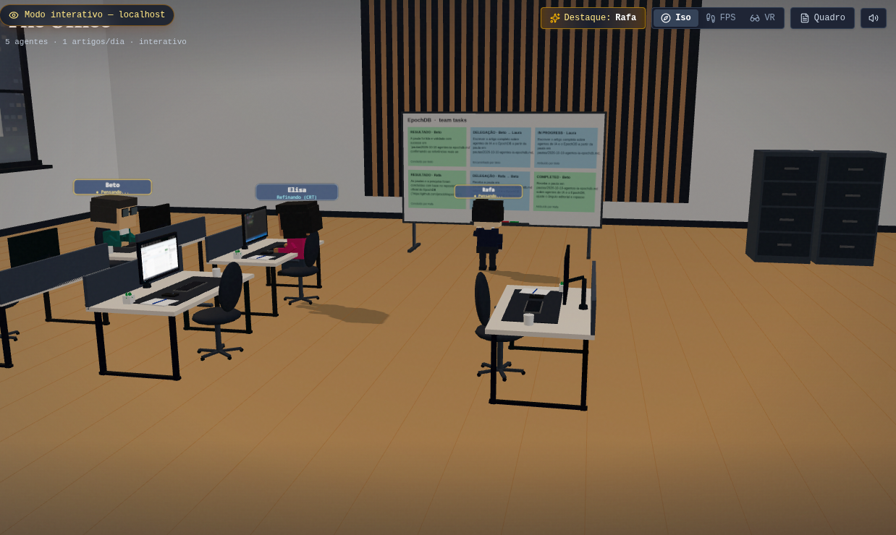

# The Office

A local newsroom you can watch. Five CrewAI desks research, write, edit, and — if you configure a blog — publish on a schedule. The shared board lives in EpochDB. Nothing in this repo is wired to a public hostname.



Open it at **http://127.0.0.1:8780**. The server binds to localhost. Docker publishes that same address and does not expose the port on your LAN.

## Interactive mode

The server starts view-only: you can watch the floor, the board, and the desk monitors. Interactive mode adds talk, task assignment, notes, and archiving.

To enable interactive mode, set this in `.env` and restart:

```bash
OFFICE_READ_ONLY=false
```

`false` is the only value that opens it. `true`, empty, `0`, and `no` all stay view-only. The badge in the corner shows which mode is running.

With Docker, recreate the container so it reads the new value:

```bash
docker compose -f docker/docker-compose.yml --env-file .env up -d
```

Interactive controls:

- Click a person and use the card at the bottom left. **Falar** opens a Gemini Live call with that desk: you can speak or type, and they can take the request, hand it to a teammate, or pin a note.
- In first-person or VR, look at someone. The microphone follows that person until you mute it.
- Open **Quadro** to assign a task, pin a note with no owner, or archive a card.

Voice audio goes from this browser to Gemini and back. It is not stored in the repo. View-only mode never opens the microphone.

The daily scheduler still runs in both modes. Interactive mode adds you as another source of tasks. It does not add a public chat API.

## Roster

Edit [`config/office.yml`](config/office.yml), then restart.

| Agent | Desk |
|-------|------|
| Rafa | Director — one sourced story per slot |
| Beto | Editor-in-chief — routes the job and closes it |
| Laura | Writer |
| Elisa | Copy editor |
| Bete | Publishing, including one cover image |

Default cadence is 3 articles, at 09:00, 13:00, and 17:00 in `America/Sao_Paulo`. Each slot opens one job.

## How a job moves

```
you or the scheduler
        │
        ▼
   Rafa (CrewAI) ──hand_off──▶ EpochDB blackboard
                                  Job · Task · Result
                                      │
                    Beto → Laura → Elisa → Bete
```

CrewAI **1.15.26** runs the desk that just woke up. Delegation inside CrewAI is off, so work moves only through `hand_off` on the board. When a desk finishes, EpochDB stores the delivery. The next desk recalls related atoms before it starts.

CrewAI's own LanceDB memory is disabled. Recall goes through EpochDB.

## Run it

```bash
cd the-office-crewai
cp .env.example .env
# set GEMINI_API_KEY
# set OFFICE_READ_ONLY=false to enable interactive mode

docker compose -f docker/docker-compose.yml --env-file .env up --build
```

Then open http://127.0.0.1:8780.

Without Docker:

```bash
python -m venv .venv && source .venv/bin/activate
pip install -r backend/requirements.txt
playwright install chromium
cd frontend && npm install && npm run build && cd ..
python backend/main.py
```

Frontend dev server (proxies to 127.0.0.1:8780):

```bash
cd frontend && npm run dev
```

## Environment

Copy `.env.example` to `.env`. Restart after any change. Docker reads that file through `--env-file .env`. Inside the container, Compose forces `OFFICE_HOST=0.0.0.0` and still publishes the port only on `127.0.0.1`.

| Variable | Default | Purpose |
|----------|---------|---------|
| `GEMINI_API_KEY` | required | Desk text, live voice, cover images, and EpochDB embeddings. |
| `OFFICE_READ_ONLY` | `true` | `false` enables interactive mode. Any other value stays view-only. |
| `OFFICE_HOST` | `127.0.0.1` | Address for `python backend/main.py`. Docker overrides this inside the container. |
| `OFFICE_PORT` | `8780` | Listen port, and the host port Docker publishes on `127.0.0.1`. |
| `APP_URL` | `http://127.0.0.1:8780` | Local URL shown for this office. |
| `GEMINI_TEXT_MODEL` | `gemini-3.5-flash-lite` | Model for desk writing and tool calls. |
| `GEMINI_VOICE_MODEL` | `gemini-3.8-live` | Gemini Live model for **Falar**. Used only when interactive mode is on. |
| `GEMINI_IMAGE_MODEL` | `gemini-3.1-flash-image` | Model Bete uses for the one cover image per post. |
| `EPOCHDB_MODEL` | `google:gemini-embedding-2` when an API key is set | Embedding model for board recall. `EPOCHDB_EMBEDDING_MODEL` is an alias. |
| `EPOCHDB_DIM` | `768` | Embedding size. `768` matches `gemini-embedding-2`. |
| `OFFICE_LANGUAGE` | `pt-BR` | Language the desks write and speak. `en` or `en-US` selects English. When this is unset, `language` in `config/office.yml` is used. |
| `TZ` | `America/Sao_Paulo` | Clock for the process. Publish-slot times follow `timezone` in `config/office.yml`. |
| `OFFICE_SCHEDULER_ENABLED` | `true` | `false`, `0`, `no`, or `off` pauses new daily slots. Tasks already on the board still resume. |
| `OFFICE_KICKOFF_ON_START` | `false` | `true`, `1`, or `yes` opens one slot as soon as the server boots. |
| `CREWAI_VERBOSE` | `true` | `false`, `0`, or `no` hides the desk tool log. |
| `BLOGGER_BLOG_URL` | empty | Blog to publish to. Leave empty to keep publishing off. |
| `BLOGGER_CLIENT_ID` | empty | Google OAuth client for the Blogger API. |
| `BLOGGER_CLIENT_SECRET` | empty | OAuth client secret. Keep this in `.env` only. |
| `BLOGGER_TOKEN_FILE` | `./secrets/blogger_credentials.json` | Where `blogger_auth.py` writes the token. Docker stores the writable copy under `data/`. |

## Publishing

Publishing is off until you opt in. There is no blog URL in the repo.

1. Create a Google OAuth desktop client with the Blogger API enabled.
2. Put `BLOGGER_CLIENT_ID`, `BLOGGER_CLIENT_SECRET`, and `BLOGGER_BLOG_URL` in `.env` (not in git).
3. Run `python backend/blogger_auth.py`. It listens on http://127.0.0.1:8080/ and writes a token JSON.
4. Move that file to `secrets/blogger_credentials.json`. Docker mounts `secrets/` read-only and copies the token into `data/` so a refresh can be saved.

`post_to_blogger` refuses a near-duplicate title. Do not enable force.

## What stays on your machine

These paths are gitignored. Do not commit them.

| Path | Contents |
|------|----------|
| `.env` | API keys and OAuth client |
| `secrets/` | Blogger token JSON. Only `.gitkeep` is tracked. |
| `data/` | EpochDB WAL, knowledge graph, job state, refreshed token |
| `workspace/**/*.md` | Articles, pautas, and publication reports the desks write |
| `workspace/imagens/` | Cover files |

A restart reloads the board from `data/blackboard/blackboard/global/wal.jsonl`. Deleting `data/` starts a blank newsroom.

## Layout

```
config/office.yml       roster, slots, prompts
backend/main.py         localhost API, view-only or interactive
backend/office.py       desks, jobs, handoffs
backend/scheduler.py    one article per slot
backend/runtime/        CrewAI kickoff, EpochDB, browser, Blogger
frontend/               isometric / FPS / VR
docker/                 local compose file, bound to 127.0.0.1
```

## Stack

| Piece | Role |
|-------|------|
| CrewAI 1.15.26 | Tool loop for the desk that is awake |
| Gemini | Desks use `gemini-3.5-flash-lite`. Live voice uses `gemini-3.8-live`. Covers use a separate image model. |
| EpochDB ≥ 1.11.2 | Board atoms and recall. Embeddings use `google:gemini-embedding-2` at 768 dimensions when `GEMINI_API_KEY` is set |
| FastAPI | Health, office snapshot, jobs, SSE, monitor WebSocket, and the interactive writes |
| Playwright | One headless Chromium page per desk, mirrored onto that monitor |

## License

[MIT](LICENSE). Dependencies stay under their own licenses and are not vendored into this repo.

The ambient loop in `frontend/src/assets/bg.wav` is by Fupicat, who gave permission to use it and does not require credit.
